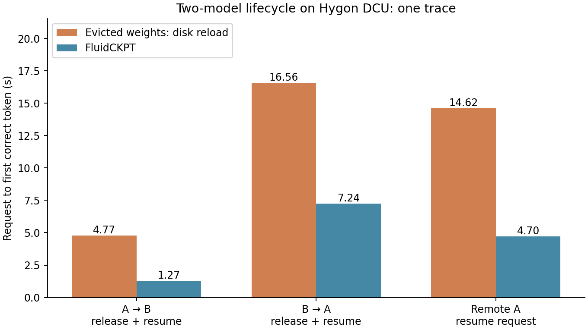
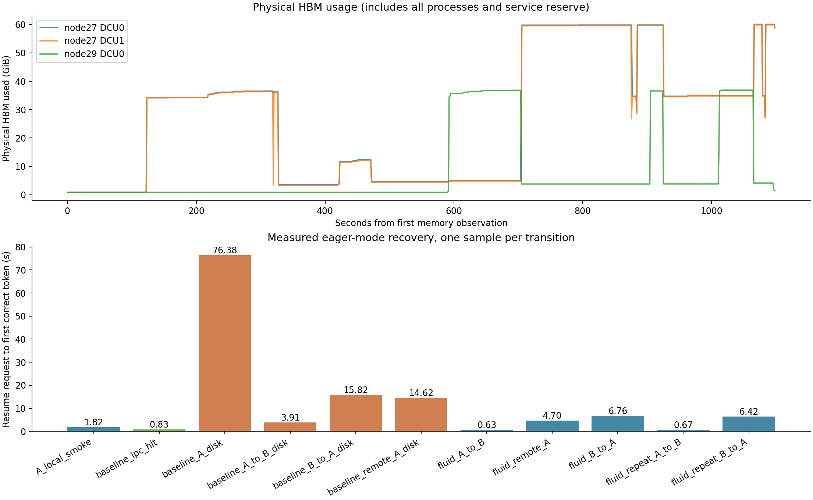

# FluidCKPT 四节点双模型生命周期实测

日期：2026-10-03；run：`final03`；状态：passed。

已完成真实 A→B→远端A→本地A及重复切换。A为Qwen3.6-35B-A3B，B为9g_8b_thinking_llama；均TP2、eager推理。

node27提供本地服务，node28提供DRAM保活，node29运行远端A，node30提供CPU/本地NVMe文件服务。每个本地服务GPU实际分配22GiB压力预留，模拟其他业务/KV所需空间；真实KV与运行时另计。

基线是用户认可的HIP IPC机制适配，以及HBM逐出后在同一已初始化引擎中执行原生磁盘loader的回载路径。不是厂商镜像原生Weight Cache Daemon测评。双方复用warm engine，避免把引擎重启成本只算给基线。

## 端到端观察

| 场景 | 逐出后磁盘回载s | FluidCKPT s | 观察到的比值 |
| --- | ---: | ---: | ---: |
| A→B（含释放） | 4.771 | 1.271 | 3.75× |
| B→A（含释放） | 16.559 | 7.237 | 2.29× |
| 远端请求A | 14.617 | 4.701 | 3.11× |

表中终点都是首个正确token。纯resident HIP IPC命中为0.828s，仍快于完整的远端恢复。上述比值只描述这条容量受限轨迹。

单独的首次A磁盘回载为76.383s；表内采用随后的对应切换观测。page cache采用系统自然状态，首次/重复路径差异尚未单独归因。





## 权重实际位置与校验

- `node30:ssd`：1,073,741,824 bytes（1.0000 GiB）。
- `node28:dram`：69,255,976,288 bytes（64.4997 GiB）。

A停放后，本地没有其保活权重HBM或DRAM副本；warm engine仍持有运行时/KV等开销，因此不宣称整卡显存归零。
迁移完整校验了70,329,718,112 bytes；远端恢复再次进行完整SHA256校验。所有恢复生成均匹配原始输出。

MILP求解0.0556s，gap=0；最优性只限给定块、候选和近似服务模型。恢复计划使用资源约束LP。

## 必须单独计入的成本

一次分布迁移共58.999s，其中分配/准备13.758s、执行传输5.613s、完整校验及发布39.628s。这些工作在B服务期间执行，不包含在随后A的恢复延迟里。

首次模型加载、注册保活内存、引擎初始化和初次预热也没有消失，只支付在初始化阶段。当前结果不能代表首次请求或迁移未完成时的紧急召回。

- `A_node27` 一次性启动、捕获/恢复、预热与参考生成：318.32s。
- `B_node27` 一次性启动、捕获/恢复、预热与参考生成：143.02s。
- `A_node29` 一次性启动、捕获/恢复、预热与参考生成：232.18s。

显式副本容量与物理HBM有记录；迁移时旧/新副本暂时共存。当前未用统一硬额度封顶所有进程RSS和内核page cache，后续严格同预算评估需补齐这部分账本。

## B的服务表现

空闲对照5次请求，迁移/恢复期间22次；全部输出一致，无请求错误。
TTFT中位数：205.72→213.48ms；期间最大观察值261.91ms。样本不足以报告P99保证。

## SSD与page cache

node30本地NVMe目录真实写入并提交1.00GiB；文件服务应用层累计读取5.00GiB。策略是buffered I/O、fsync及POSIX_FADV_DONTNEED；该读取计数不是NVMe物理读计数。未修改Linux内核。

当前SSD经CPU HTTP代理供给GPU，性能包含文件读取、网络、临时内存和H2D等开销。不能把整条路径的耗时归因于SSD硬件。

## 结论边界与下一步

这是一条真实、固定配置的功能与性能轨迹，尚未完成随机化成对重复、更多模型/上下文、原生CPU backup或多层缓存的强基线，以及MILP相对简单策略的消融。单独观察到端到端收益不证明MILP的增量收益。

下一步优先比较同量HBM保留慢路径区域与均分/热度策略；拆分SSD代理的读取、固定内存和H2D开销；让迁移可分段提交并接受中途召回；严格计入迁移峰值和一次性准备成本。

执行代码指纹变化：`[]`。清理错误：`[]`。

原始数据：[summary.json](../../codex_coding/results/lifecycle/final03/summary.json)、[analysis.json](../../codex_coding/results/lifecycle/final03/analysis.json)、[会话与命令](../../codex_coding/results/lifecycle/final03/session.json)。

## 复现命令

在项目根目录运行；使用新的run名称：

```bash
python3 codex_coding/src/task2/cluster/run_lifecycle.py --run <new_run> --local-dram-gib 0 --port-base 29100
python3 codex_coding/src/task2/cluster/analyze_lifecycle.py --run-dir codex_coding/results/lifecycle/<new_run>
# Plot with a Python environment containing matplotlib and numpy:
python codex_coding/src/plt/plot_lifecycle.py --run-dir codex_coding/results/lifecycle/<new_run>
```
