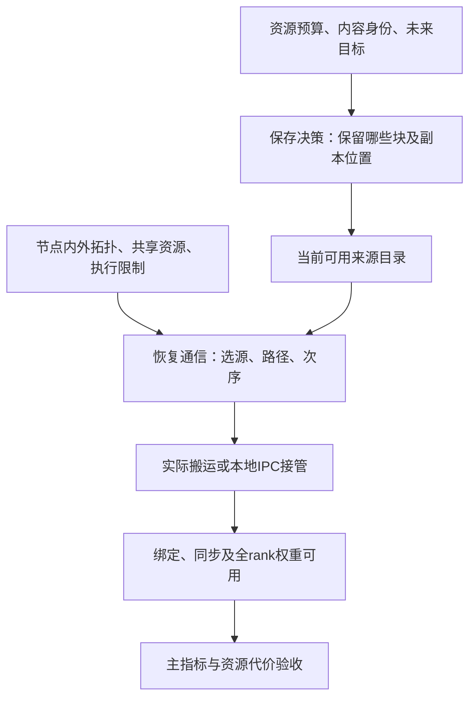

# 多节点权重保活、布放与拓扑感知通信：文献及建设参考

- 建立日期：2026-10-06；文档版本：1.0。
- 项目：FluidCKPT；开发编号保持 `v0.1.23.3 / task2`。
- 用途：后续解释实验、选择强基线、修改成本模型或讨论新组件之前的长期参考。
- 依据：原论文、正式会议页面、作者公开代码，以及本项目已有实现和实验记录。
- 阅读范围：已核对所列工作的问题定义与核心方法章节，代码核查到公开接口/说明；未复现作者系统，也未逐条复核全部证明。具体模型适用条件与实现状态见各节。
- 文档性质：文献分析与项目映射；映射模型是设计参考，不代表已实现、已验证或已经证明新颖。

## 1. 先读这一页：哪些结论可以直接使用

FluidCKPT 研究：在固定模型版本、固定计算分片以及明确资源预算下，暂停模型的权重如何保存，并在给定目标设备组上尽快恢复可用。权重保存在哪个节点、哪个NUMA/存储层，决定未来可选来源；实际路由、共享资源与执行顺序决定这些来源能多快完成供给。

文献已经建立了以下基础：多层加载与启动位置选择、计算网络上的权重分发、拓扑感知路由和排程、共享带宽约束、瓶颈割与多源树打包。后续应引用并复用这些基础，而不是重复推导后当作本项目新贡献。对应来源集中列在第4–6节。

当前要核对的增量是：**已有方法在我们的长期保活预算、权重内容身份、未来恢复目标、节点内外共享资源和实际执行限制同时存在时，是否仍足够；如果不够，具体少了哪项决策或约束？** 这个问题本身尚不构成创新证明。

推荐使用顺序：

1. 第2–3节：统一术语，分清保存位置、通信和引擎就绪。
2. 第4节：优先读BlitzScale、ServerlessLLM，了解直接相关的系统对照。
3. 第5节：优先读TE-CCL，再用ForestColl、TACCL、SCCL核对拓扑与时序模型。
4. 第6节：回顾Helix，避免把token吞吐最大流直接套到权重恢复。
5. 第7–10节：对照当前实现、e3–e6证据和建设准入条件。

项目入口：[最新计划](../plans/2026-10-04_v0.1.23.3_task2_paper_e1_e8_plan.md)、[正式实验报告](../experiments/2026-10-04_v0.1.23.3_task2_paper_e1_e8_records.md)、[范围管理指南](../01_paper_scope_management_guide.md)。

## 2. 术语与不同优化目标

| 术语 | 在本项目中的直观含义 | 使用时注意 |
| --- | --- | --- |
| 权重保活 | 引擎暂停后，由存储对象继续持有可复用权重 | IPC句柄只是访问凭证，真正占空间的是分配及其owner |
| placement / 布放 | 哪些内容、多少副本放在哪个位置 | 保存位置与计算设备组是两个决策；本篇先固定计算分片 |
| chunk / extent | 可定位的权重字节区间 | 逻辑片段不必然可独立物理释放；需要核对allocation |
| commodity / 商品 | 流模型中一种必须区分身份的传输需求 | 不同内容/不兼容布局的TP分片不可替代；同内容副本是可选来源 |
| routing / 路由 | 数据从何处沿哪些可用连接到达目标 | 网络底层路由和应用选择relay不一定都可控 |
| scheduling / 排程 | 哪个块何时发送、等待谁、占用哪些资源 | 有足够总带宽不代表当前块已经可发送 |
| relay / 中继 | 收到数据后再向其他目标发送的端点 | 要计入临时存储、收发顺序和额外流量 |
| scale-up / scale-out | 节点内高速互连 / 节点间网络 | 不能假定节点内成本为零或所有节点间链路独立 |
| multicast / 组播 | 同一份内容发给多个消费者 | 不同TP rank需要不同分片时，不能把完整模型广播作为唯一基线 |
| shared resource / 共享资源 | 多条传输共同占用的出口、总线、内存控制器等 | 逻辑路径不同不代表物理瓶颈不同 |
| cut / 割 | 将网络分成两部分后，必须跨越的连接集合 | 下界由真正必须跨越的内容与容量确定，副本位置会改变必需流量 |
| makespan | 这一批任务全部完成的时间 | 模型恢复关心最后一个必要rank，而非最快链路 |
| throughput | 稳态单位时间完成的数据或请求量 | 大消息稳态吞吐最优不自动意味着完整恢复时延最小 |
| time-expanded graph | 将同一节点在不同时间片展开 | 表达“收到以后才能转发”和等待、暂存等状态 |

当前主指标为同一目标主机的 `max(weights_ready) - min(load_begin)`。跨机TP需分开报告各主机窗口与协调端全体ready确认，未经校准不得相减不同主机的单调时钟。论文中的TTFT、扩容吞吐和纯collective时延均应保留原定义，不直接拼成我们的主指标。具体计时契约见最新计划第3节。

## 3. 三个相连但不同的决策层



**保存层**决定长期占用和未来可用来源。**通信层**在给定来源下完成一次数据交付。**引擎层**保证这些字节具有正确布局、量化属性和可执行状态。已有工作可能覆盖其中多层；不能只因某篇collective论文没有长期保存变量，就断言所有模型服务系统都没解决placement。

外层可以调用固定布局的通信模型评估恢复成本。这是一种组织方式，不要求实现两个全新的求解器。先检查现有简单策略、联合接口以及文献方法能否表达所需约束。

## 4. 直接相关的模型加载与分发系统

### 4.1 ServerlessLLM：多层加载与启动时间感知选址

**正式题名：** *ServerlessLLM: Low-Latency Serverless Inference for Large Language Models*，OSDI 2024。

论文将加载优化的存储格式、固定内存块池和多层流水线与服务器选择相连。加载时间估计包含排队、数据量和带宽，调度结合服务器本地DRAM/SSD状态及必要迁移成本；方法章节还说明串行加载队列的处理。它也有缓存布放策略，实验包含热度复制、round-robin位置安排及LRU。优先读§4加载路径、§6调度和§7实验设置。[论文](https://www.usenix.org/system/files/osdi24-fu.pdf)；[会议页](https://www.usenix.org/conference/osdi24/presentation/fu)；[代码](https://github.com/ServerlessLLM/ServerlessLLM)。

**项目使用方式：**作为多层加载和缓存局部性系统对照。若固定恢复设备组，要明确外部设备约束；不能禁止对手合法选址后，把“不让它移动”产生的差距当作加载算法优势。是否直接复用loader取决于处理后格式、引擎与硬件适配。

### 4.2 BlitzScale：计算网络上的权重分发与live scaling

**正式题名：** *BlitzScale: Fast and Live Large Model Autoscaling with O(1) Host Caching*，OSDI 2025。

§5.1用高速scale-up组和简化leaf–spine网络生成多源转发计划，考虑目标扩容、计划生成和服务干扰；未显式建模spine内部路由。§5.3已有长期GPU/CPU参数池：初始化将一份参数均匀放到CPU hosts，持续更新源目录和host缓存；附录A.1讨论故障后重分布。O(1)指每模型常数份缓存，字节仍随模型大小增长。[论文](https://www.usenix.org/system/files/osdi25-zhang-dingyan.pdf)；[会议页](https://www.usenix.org/conference/osdi25/presentation/zhang-dingyan)。

**项目使用方式：**优先借鉴其拓扑感知贪心、来源分组和权重分发，核对“现有副本如何供给新实例”这一直接竞争路线。live scaling可在全部权重到齐前承担部分计算，而我们的主指标要求全部必要权重可用；评价时分别列这两个终点。

**比较时的研究问题：**需要逐项核对其均匀初始化/缓存管理与我们的显式HBM、NUMA DRAM、SSD预算以及指定恢复目标的关系，不能概括为“它只做通信、我们首次做长期placement”。

**容量前提：**论文假设集群聚合host memory能够保存所有模型的缓存参数，并维持每模型至少一份内存参数。其O(1)复制开销不能外推为任意严格字节预算下都能保证可行。

**实现核查：**2026-10-06访问的[作者仓库](https://github.com/blitz-serving/blitz-scale)标注实现仍在整理，并列出模型生成正确性问题。可以阅读/复用planner思想，完整海光推理基线需独立适配与验收；不把仓库问题当成论文方法无效，也不将未跑通实现记为无限慢。

### 4.3 FaaScale / λScale：分块流水组播

**正式发表版本：** *FaaScale: Unlocking Fast LLM Scaling for Serverless Inference*，MLSys 2026。

该工作采用块级流水组播以及计算—传输重叠，利用已有完整来源扩展服务；PipeCast和多源组织是阅读重点（§3–5）。相关预印本为 *λScale: Enabling Fast Scaling for Serverless Large Language Model Inference*，arXiv:2502.09922。二者作者、方法和公开代码线高度相关，本笔记按同一研究线管理；逐版本差异尚未作完整逐段比对。[正式论文](https://proceedings.mlsys.org/paper_files/paper/2026/file/6e32c247076c2c0fb381e022c02d2c78-Paper-Conference.pdf)；[预印本](https://arxiv.org/abs/2502.09922)；[RDMA实现](https://github.com/lambda-scale/rdma-p2p)。

**项目使用方式：**多个恢复目标确实需要同一内容时，再考虑组播/转发与流水。互斥未来场景的概率加权不等于多个目标同时消费，当前TP分片恢复也不能直接替换成全模型广播。是否新增relay应先有共享流量和临时预算依据。

**来源前提：**方法依赖至少一份RDMA可访问的已注册GPU或host memory完整来源，块粒度通过离线profile选择，面向稳定RDMA网络；仅有SSD底本的阶段需要另计读入和注册。

### 4.4 SpotServe：复用已有分片来减少重配置搬运

**题名：** *SpotServe: Serving Generative Large Language Models on Preemptible Instances*，ASPLOS 2024。

它应对抢占实例上的并行配置变化，使用设备与逻辑位置的匹配来复用已有权重/KV，并安排受迁移缓冲限制的搬运顺序。重点是§5重配置与迁移。[论文](https://arxiv.org/abs/2311.15566)；[作者代码](https://github.com/Hsword/SpotServe)。

**项目使用方式：**借鉴数据复用、设备匹配和迁移暂存约束。我们的初期范围固定TP，不因引用它就新增任意重分片。减少搬运字节与减少恢复时间需要分开验证：不同路径成本和共享瓶颈会影响最后一个rank到齐时间。

## 5. 拓扑感知通信的理论与可执行方法

### 5.1 SCCL：给定初末状态，合成合法collective

**题名：** *Synthesizing Optimal Collective Algorithms*，PPoPP 2021。

SCCL通过初始/最终chunk分布、steps/rounds和SMT表达通信算法。带宽关系可以限制一组边每轮合计的发送量，而不只约束单边，适合表达共享出口或总线。其Pareto最优属于限定的算法模型，不能推广为任意网络/运行时的全局最优。[论文v2](https://arxiv.org/abs/2008.08708v2)；[官方后续工具说明](https://github.com/microsoft/msccl-tools/blob/main/SYNTHESIS.md)。

**项目使用方式：**复用pre/post、先收后发和边组容量概念。多个副本可以写入初始状态，但其保存位置在一次通信合成中属于输入；长期placement要在外层处理。

### 5.2 TACCL：借助通信sketch缩小拓扑搜索空间

**题名：** *TACCL: Guiding Collective Algorithm Synthesis using Communication Sketches*，NSDI 2023。

TACCL输入实测拓扑、消息规模和通信sketch，将部分结构选择交给用户，再求路由、排序与排程。不同连接数的限制与发送/接收不重叠是两套机制，后者见附录B.3 Eq.(19)–(21)。最后阶段的精确排程是在既定路由和顺序下求解，不能称为全过程全局最优。重点读§3–5及附录B。[论文](https://www.usenix.org/system/files/nsdi23-shah.pdf)；[会议页](https://www.usenix.org/conference/nsdi23/presentation/shah)；[代码](https://github.com/microsoft/taccl)。

**项目使用方式：**物理拓扑复杂时先保留必要的relay/连接选择，借用小搜索空间和可执行排程。sketch会限定搜索范围；连接数控制不是所有NUMA、内存和NIC争用的统一精确模型。具体硬件仍需匹配测量。

### 5.3 TE-CCL：时间、容量、数据可用性一起建模

**题名：** *Rethinking Machine Learning Collective Communication as a Multi-Commodity Flow Problem*，SIGCOMM 2024。

TE-CCL用有向容量图和时间epoch表达数据传输，处理到达延迟、数据保存/复制以及目标需求。一般形式含整数变量，特定需求可简化为LP。§3目标通过加权奖励较早满足的需求，配合§5时间范围搜索；不能将这一目标逐字等同严格min-max makespan。A*式分段方法有次优性边界。[论文](https://www.sivak.dev/assets/pdf/sigcomm24_teccl.pdf)；[作者页](https://www.sivak.dev/projects/13-teccl)；[代码](https://github.com/microsoft/TE-CCL)。

**项目使用方式：**当流体带宽模型与有限块实际次序差异明显时，优先参考其数据可用性和时序约束。其原始需求给定源和目标；把副本作为可选源要保持同一内容身份，避免重复要求目标接收。时间粒度/求解成本也要计入，不能为解释一个等待项直接移植整套合成器。

### 5.4 ForestColl：异构交换网络上的树打包与吞吐下界

**正式题名：** *ForestColl: Throughput-Optimal Collective Communications on Heterogeneous Network Fabrics*，NSDI 2026。

ForestColl以瓶颈割、流和生成树打包组织多根通信，并用edge splitting处理交换节点；不必假定交换机具有网络内组播。基本最优性讨论使用容量平衡的Eulerian条件，即各节点总入口容量等于总出口容量；并非所有节点带宽相同。其重点是吞吐与离线生成，有限消息时延还受启动和流水影响。重点读§4–5及相关附录。[正式论文](https://www.usenix.org/system/files/nsdi26-zhao-liangyu.pdf)；[会议页](https://www.usenix.org/conference/nsdi26/presentation/zhao-liangyu)；[代码](https://github.com/liangyuRain/ForestColl)。

**项目使用方式：**作为固定初始布局下多源/广播类需求的下界和候选通信基线。TP分片到指定rank的需求未必是标准AllGather，需要先证明转换保留需求和成本；额外发送无用内容会改变比较问题。

## 6. Helix 的位置：借联合框架，保留流的物理含义

**正式题名：** *Helix: Serving Large Language Models over Heterogeneous GPUs and Network via Max-Flow*，ASPLOS 2025；DOI `10.1145/3669940.3707215`。

Helix把层放置与请求调度联合建模，图容量反映异构GPU计算和网络供给，流量单位为token/s。整数变量选择层位置，流变量描述持续推理分配；它不是在求一次权重回载的字节流。优先读正式版本§4建模与§5运行时。[论文v2](https://arxiv.org/abs/2406.01566v2)；[本地PDF](../papers/3669940.3707215-helix.pdf)；[代码](https://github.com/Thesys-lab/Helix-ASPLOS25)。

本项目已在[9月28日计划§3](../plans/2026-09-28_task2_numa_flow_loading_plan.md)记录了借鉴边界：入口/出口拆分、共享容量、放置与路径联合、消融可以借用；权重内容身份、bytes/s单位、有限恢复完成时间以及在途空间要重新对应。后续先读这个已有入口，不再从零推导“最大流是什么”。

## 7. 可以直接复用的建模语言

以下是对前述方法的统一记号与项目映射，便于讨论和接口设计。它们是标准容量/完成约束的简化表达，不是本项目新定理，也不是已确定采用的完整优化器。

### 7.1 保存预算与内容覆盖

令 `b` 表示具有固定内容身份的权重块，大小 `s_b`（bytes）；`l` 表示具体存储位置；`x[b,l]∈{0,1}` 表示此处保留该块。

对每个实际容量池 `m`：

```text
sum(size_allocated(b,l) * x[b,l] for allocations charged to m)
    + reserved_service(m) + staging(m) <= capacity(m)
```

`size_allocated`应按实际分配粒度计费。一个副本可同时受GPU预算、节点预算等不同上限约束，但全系统实际字节总账不能重复求和这些上限。完整后备、额外缓存和目标分配分别记录。区间重叠、TP identity、版本和有效状态由目录验证，不能只看总字节数是否相等。

未来目标场景若互斥，可使用预登记的权重评估期望恢复成本；同时发生的恢复必须共享容量并一起排程，两者不能混用。

### 7.2 共享资源容量，优先于“每条路径各有一份带宽”

对传输 `o`，令 `r_o(t)` 为某时刻速率，`a[m,o]` 表示它在资源 `m` 上消耗的份额。简化约束为：

```text
sum(a[m,o] * r_o(t) for active transfers o) <= effective_capacity(m,t)
```

该表达借用SCCL的边组容量和TE-CCL的时间容量思想。模型必须明确一次传输实际经过哪些资源；逻辑路径边不相交不能据此断言NIC/PCIe/内存控制器独立。按worker串行执行可以先表示为参与操作的互斥/先后关系，不必猜测硬件饱和率。

容量约束限制一段时间内的通信量，互斥约束限制操作能否重叠，两者不能互换。TACCL的switched send/recv分别受序列化约束；我们当前worker在一个循环中执行全部关联操作，收和发共用的顺序限制需要按实际代码表达，不能认为抄一个发送端约束就完全一致。

有效容量需有配置和测量出处。当前占位profile不能用来宣称真实交换网络已建模；前台干扰造成的容量变化也不能不经测量就当作常数。

### 7.3 固定布局的恢复下界与可执行时间

设 `D_m` 为一次恢复在资源m上必须完成的工作量，`C_m`为对应速率，一个常用负载下界为：

```text
T_transfer >= max_m(D_m / C_m)
```

这里的工作量取决于具体布局、选源和路径，首先给出**已选传输计划**的负载下界。若要评估整个placement x的最佳恢复，应对其所有允许的选源/路径方案π求最小，或使用对所有可行方案都成立的必需工作量：

```text
L(x) = min_{π in allowed_plans(x)} max_m D_m(x,π)/C_m
```

只有允许方案集合覆盖待比较的可执行方案且容量假设正确，L(x)才是该模型下最优传输时间的下界；不能用某条差路径造成的大负载排除整个placement。若能证明某割上至少有多少不同内容必须跨越，也可由相应容量得到下界。多副本、目标重叠和中继复制会改变“必需”的定义，不能直接套普通单商品最小割结论。

**容量条件：**严格物理下界要求C_m是有效服务能力上界。单流平均实测带宽或拟合的effective capacity不天然满足这个条件，使用它们计算时应称“模型内下界/成本估计”。时变容量对应的必要条件是 `D_m <= integral_0^T C_m(t) dt`，不能任取某个时刻的容量作除法。

有限消息还受启动延迟、先收后发、块粒度、串行操作与目标ready同步影响。流体下界有助于排除差方案或构建参考，是否可达必须由执行计划与实测判断；ForestColl的条件性吞吐保证和TE-CCL的时间模型应按各自目标使用。

### 7.4 数据可用性与复制

要发送某个块，源节点必须已经持有该块，或此前接收已经完成。允许中继时，必须计入暂存容量和释放时点。对组播，源可保留数据并发给多个目标，不能用“发送即消耗内容”的朴素流守恒错误禁止复制。

相同权重在两个来源各有一份时，目标需要其中一份完整内容；不能将它们当成两个都必须收到的商品。不同内容、版本或不兼容布局不可互换；TP中也可能有跨rank相同张量，因此rank编号本身不是内容不同的证明。本项目仍采用既有rank隔离目录契约，不在此引入跨rank内容去重。实现时先复用现有 `identity/tp/off/n/epoch/generation`，再考虑是否需要额外变量。

### 7.5 完整权重可用与布局建立成本

目标设备拿到字节之后，还可能需要模型绑定、GPU同步及ready确认。评价使用实际load_begin/weights_ready，不从通信吞吐公式直接推出完整恢复时延。跨主机时钟要求沿现有测量协议执行。

缓存建立可以提前发生，但要单列创建、注册、搬运、校验和发布成本。静态论文至少报告这些代价；动态调整要进一步比较累计恢复节省与实际变更成本，这属于e8的证据问题。不能为了得到低恢复时间而把新增工作静默移出窗口。

## 8. 复杂多节点拓扑如何映射到我们的系统

### 8.1 三种图不能混为一张图

| 图 | 表示什么 | 需要的证据 |
| --- | --- | --- |
| 物理资源图 | NUMA、PCIe、GPU互连、NIC/HCA、交换网络及连接 | 硬件发现、拓扑资料、实际绑定；未知段明确未知 |
| 可执行传输图 | 我们当前软件栈实际能走的来源/目标、relay和同步方式 | 已验证路径、通信库配置、权限/设备映射及chunk实现 |
| 内容位置与需求图 | 哪个有效权重区间位于哪里，哪个rank需要它 | 目录identity/版本/范围、目标TP布局、恢复场景 |

一张物理卡拥有多条连接，不代表当前worker能同时有效使用它们；TCP/RDMA后端、暂存路径和同步方式会改变可执行图。反过来，应用层两条独立连接也可能竞争同一物理出口。

### 8.2 应核对的资源，而不是预设的硬件结构

| 资源 | 对恢复的影响 | 对当前项目的处理 |
| --- | --- | --- |
| NUMA内存控制器/跨socket连接 | 多块DRAM或多卡读同一来源时可能共享 | 复用页放置与路径测量，不把每worker DRAM容量/带宽独立相加 |
| PCIe root/switch | GPU、NIC或SSD路径可能汇合 | 依据实际设备树，不将单流结果直接叠加 |
| GPU节点内互连 | 可作为本地copy或relay路径 | 海光环境以实测可达与带宽为准，不照搬NVLink组内零成本 |
| NIC/HCA与节点出入口 | 多rank跨机供给可能共享 | 保留端口/绑定身份和聚合需求；既有节点级容量只是近似 |
| 节点间交换/上联 | 路径可能存在超售与共同割 | 只有确认拓扑后才使用leaf/spine或rail标签；资料不全时说明边界 |
| SSD及文件供给链 | 读取、CPU代理、网络、H2D都可能限制 | 明确缓存状态与真实读量，不用代理总时间代替设备带宽 |
| worker与目标执行 | 操作次序、暂存复用、同步形成排队 | 已有逐op记录优先分析；逻辑串行约束与硬件带宽约束分开 |

我们要研究多节点复杂拓扑下的布放，但当前三节点参与、两目标TP2以及历史GLM TP16并不自动构成任意拓扑验证。先核对真实集群的共享关系，再选择最小可区分场景；不要为了展示优化器而虚构瓶颈。

## 9. 如何重新解释现有 e3–e6 证据

本节为本项目结果的解释，权威数据仍在[实验报告第18节](../experiments/2026-10-04_v0.1.23.3_task2_paper_e1_e8_records.md)与[机器汇总](../../codex_coding/results/v0.1.23.3/task2/paper_e1_e8/analysis/through_e6_r02/report.md)。这些不是前述论文的实验。

| 已有观察 | 文献提供的解释框架 | 仍不能由本轮推出的结论 |
| --- | --- | --- |
| e3远端B同总搬运量，集中3.798s、分散2.625s | 路由、共享源负载与操作顺序共同影响完成时间；先用TACCL/TE-CCL视角分析执行链 | 具体NIC/PCIe争用比例已确定，或分散在所有拓扑都更快 |
| e3本地A集中只用4GiB缓存，分散用8GiB | 保存副本和恢复选源是相连决策 | 存了8GiB就必然使用8GiB，或全部差值来自硬件并发 |
| e4在8GiB下greedy/MILP同布局、同操作 | 现实简单场景允许强简单策略达到同目标值 | 复杂拓扑下联合规划必然无用，或相同操作意味着不同planner总时延相同 |
| e6 0→16GiB使B约2.771→2.349s | 本地缓存减少昂贵来源供给，体现空间—时间权衡 | 同预算算法优势、完整二维前沿或动态净收益 |
| GLM全SHA通过但fresh首次输出未匹配 | 引擎绑定/运行状态是通信完成之外的正确性关口 | SHA通过就能宣称完整大模型恢复通过 |

e3原始summary已有每个worker的 `execution.records`、源/目标角色、字节与elapsed，且plan保存有序操作；可先还原共享worker依赖和最后rank完成阶段。使用同主机事件或局部耗时比较，跨机绝对时间线需校准。

**重要命名修正：**本项目现有“paired marginal greedy + fastest”是自建强简单策略，不等于已经实现BlitzScale的分层转发链，也不等于已经与TE-CCL/ForestColl完成对照。因此现有e4结论限定在已测试的候选与策略集合。

## 10. 从文献到最小建设：先建立方法对应表

### 10.1 三种复用层次

1. **概念/约束复用：**引用原方法，将数据可用性、共享容量或源选择条件映射到现有模型；无需移植整个运行时。
2. **算法复用：**在相同输入、预算、执行器上实现某篇论文的适用子算法；标注“依据论文方法的适配”，记录被改变的假设。
3. **完整系统复现：**固定作者代码commit、模型和硬件适配，完成内容及生成验收，才标为该实现的测评。CPU solver输出或CUDA程序可编译不代表海光全流程可运行。

当前优先第一层，并评估哪些第二层对照真正必要。TACCL/TE-CCL常涉及Gurobi，SCCL使用SMT，执行格式和通信库也各有依赖；选择方法前核对许可、求解成本与后端契约，而非自动引入整套依赖。

### 10.2 固定布局通信与长期布放分别验收

| 待比较内容 | 最小公平对照 | 可复用入口 | 增量成立的必要证据 |
| --- | --- | --- | --- |
| 本地HBM快速接管 | 同一可用副本的IPC绑定 | 现有IPC gate | 内容、生成和物理回收正确，计入常驻空间 |
| 固定布局下选源 | 远端感知fastest/就近规则与资源LP | `planning.py`、`control.py` | 实际source或路径改变，T_ready改善且准备成本可解释 |
| 固定布局下分发排程 | 直接传输与拓扑分组/relay；需求适用时考虑树/组播 | 先映射BlitzScale、TACCL/TE-CCL方法 | 有同内容多消费者或共享出口依据，执行器真正支持相应次序 |
| 长期缓存placement | 强简单分层/成组贪心与候选 | `joint.py`、`multi_joint.py`、现有矩阵 | 同预算下有决策/能力增量；未改变格式和数据正确性门槛 |
| 动态布局变化 | 保持旧可行布局或另一可行变更策略 | `block_migration.py` | 全程覆盖、临时预算及真实净回本 |

同一候选空间上的greedy与MILP用于隔离求解方式；它不能自动代表对所有相关系统的强比较。反之，完整作者系统若有不同目标、允许不同设备选择或提前部分服务，也不能不对齐问题就直接套用其数字。

### 10.3 下一步有限交付

后续“已有证据分析”应先提交一份小型对应表：

| 字段 | 必须填的内容 |
| --- | --- |
| 论文来源 | 方法章节、变量/约束及原始代码入口 |
| 适用需求 | 单目标分片恢复、多个相同内容目标，或互斥未来场景 |
| 真实拓扑依据 | 已知设备/共享资源与未知段；单流和并发证据分别标记 |
| 当前实现映射 | 哪些约束已有、哪些不适用、哪些确实缺失 |
| 强基线 | 固定哪些输入，如何保留对手合法能力 |
| 唯一待验证假设 | 缺失项会导致哪个实际决策或执行差异 |
| 最小实验与停止条件 | 一组可区分对照；相同决策/无收益则停止扩建 |

阅读优先级为BlitzScale与ServerlessLLM（系统对照）→TE-CCL（时序约束）→ForestColl/TACCL（按实际需求选择）→Helix既有笔记回顾。FaaScale在同内容多目标扩容确有需要时深入，SpotServe在既定迁移问题涉及设备复用时深入。

**范围边界：**本文不批准新建通用collective库、任意拓扑模拟器、需求预测或重分片系统。也不把当前两目标简单场景同解外推为复杂拓扑无价值。先完成文献—拓扑—已有证据映射，再按[最新计划第17节](../plans/2026-10-04_v0.1.23.3_task2_paper_e1_e8_plan.md)决定最小新增。

## 11. 与仓库实现及既有阅读的连接

| 本地入口 | 已经有什么 | 查阅目的 |
| --- | --- | --- |
| [9月28日拓扑与流计划](../plans/2026-09-28_task2_numa_flow_loading_plan.md) | Helix映射、bytes/s、共享资源与测量契约 | 避免重新推导基本框架 |
| [9月29日联合放置认识](2026-09-29_task2_joint_placement_findings.md) | 副本、逐块流和联合问题讨论 | 保留历史假设，与新实测区分 |
| [生命周期设计](../plans/2026-10-03_fluidckpt_lifecycle_design.md) | 状态、迁移与瞬态容量 | 复用已有迁移设计，不另造生命周期 |
| [planning.py](../../main_lib/fluidckpt/cluster/planning.py) | 路径/资源容量、目标串行服务、来源选择 | 核对当前近似已覆盖什么 |
| [multi_joint.py](../../main_lib/fluidckpt/cluster/multi_joint.py) | 互斥场景下有限候选联合布放 | 区分未来场景与同时并发需求 |
| [worker.py](../../main_lib/fluidckpt/cluster/worker.py) | 有序执行、暂存、同步与逐op记录 | 对照文献排程是否真的可执行 |
| [block_migration.py](../../main_lib/fluidckpt/cluster/block_migration.py) | 独立块、峰值约束、先发布后退役 | 检查动态过程的可行性 |
| [e1–e8报告](../experiments/2026-10-04_v0.1.23.3_task2_paper_e1_e8_records.md) | 原始run、失败、别名及指标 | 防止文献性能数字与我们的结果混用 |

现有实现中的 `network_node_GBps`、`dram_GBps` 等标量仅表示当前profile抽象。它们是否忠实代表共享NIC、多个HCA或交换上联，要用实际拓扑和测量验证；不能把名字当作已经完成复杂网络建模的证据。

## 12. 引用、版本和维护

本文的论文介绍主要依据正式论文方法章节；公开仓库状态以2026-10-06查阅为准，后续运行前重新固定commit。Helix优先使用ASPLOS正式版/arXiv v2，不把v1与v2的性能数字拼接；ForestColl使用NSDI 2026正式题名；FaaScale与λScale按同研究线记录，准确版本差异待逐项比对。

本文没有将文献的加速倍数列为本项目预期收益，也没有完成穷尽的新颖性排查。新增工作应补入相应方法族，记录其问题、假设、适用条件、代码和对我们决策的影响，不只追加论文标题。

更新本文时分清：

- **论文事实：**指向正式PDF、具体章节或作者代码。
- **项目映射：**标明如何改单位、变量和需求，以及保留/舍弃哪些假设。
- **已有实测：**引用正式报告的run_id，保留指标边界与失败。
- **待验证假设：**给出最小实验和停止条件，不提前写成结论。

| 日期 | 版本 | 内容 |
| --- | --- | --- |
| 2026-10-06 | 1.0 | 汇总9条工作线、理论映射、复杂拓扑视角、现有e3–e6解释及最小复用流程；未启动实验或修改产品代码 |
